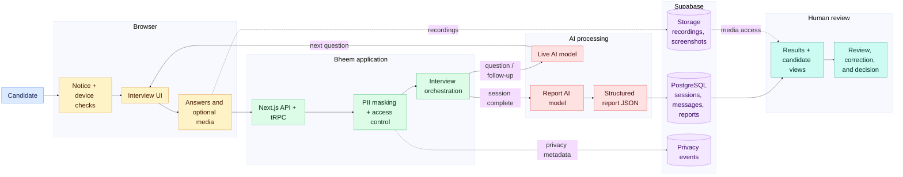
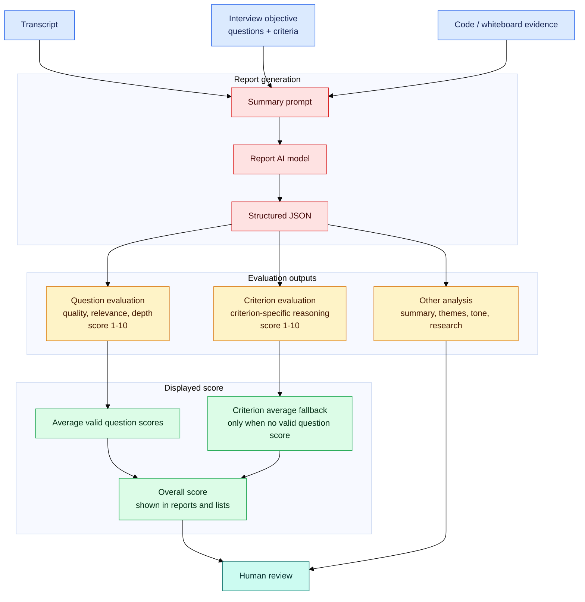
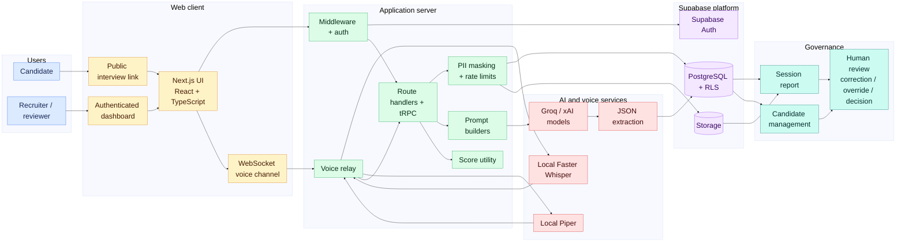

# Bheem AI Interview Bot Diagrams

These diagrams are designed for A4 landscape presentation pages. They use compact left-to-right composition, short labels, and grouped system boundaries.

## 1. End-to-End Data Flow

### Flow legend

- **Browser:** candidate-facing notices, interview interaction, device checks, and optional evidence capture.
- **Bheem application:** authentication, API routing, PII masking, interview orchestration, and completion handling.
- **Processing:** local speech services plus hosted models for live interaction and final reporting.
- **Supabase:** structured records, protected media, and privacy-event metadata.
- **Review:** AI results are presented to a human reviewer before an organisation decision.

## 2. Evaluation and Score Path

**Scoring rule:** the headline score is the arithmetic mean of valid per-question scores. Assessment-criterion scores are displayed separately and are used only as a fallback when no valid question score exists. Tone, sentiment, themes, duration, and anti-cheating events do not automatically change the score.

## 3. System Architecture

### Architecture responsibilities

| Boundary | Responsibility |
|---|---|
| Web client | Notices, interview interaction, device checks, media capture, and dashboards |
| Application server | Authentication, access control, routing, PII masking, prompts, persistence, and scoring |
| AI and voice services | Local speech processing and hosted live/report model calls |
| Supabase | Auth, PostgreSQL records with RLS, and protected media storage |
| Governance | Human interpretation, correction, override, and final organisation decision |
