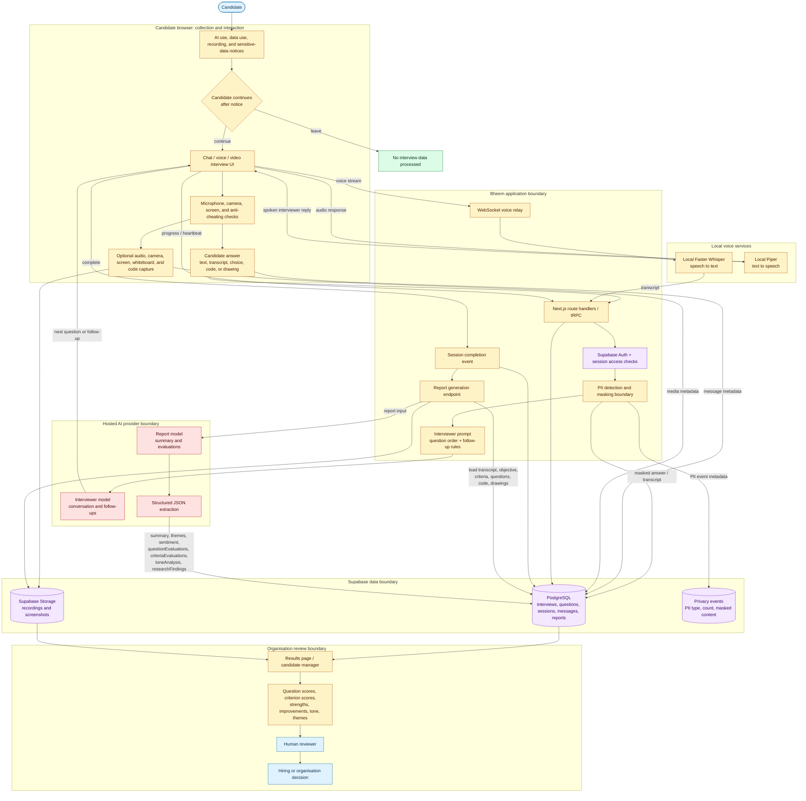
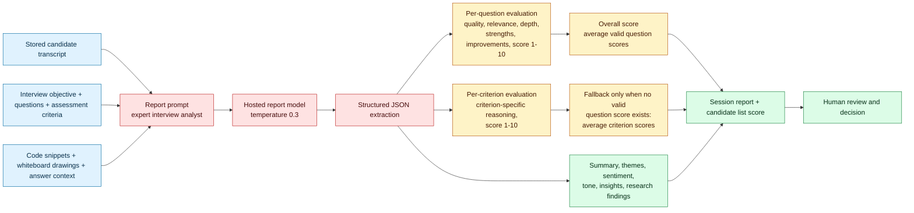
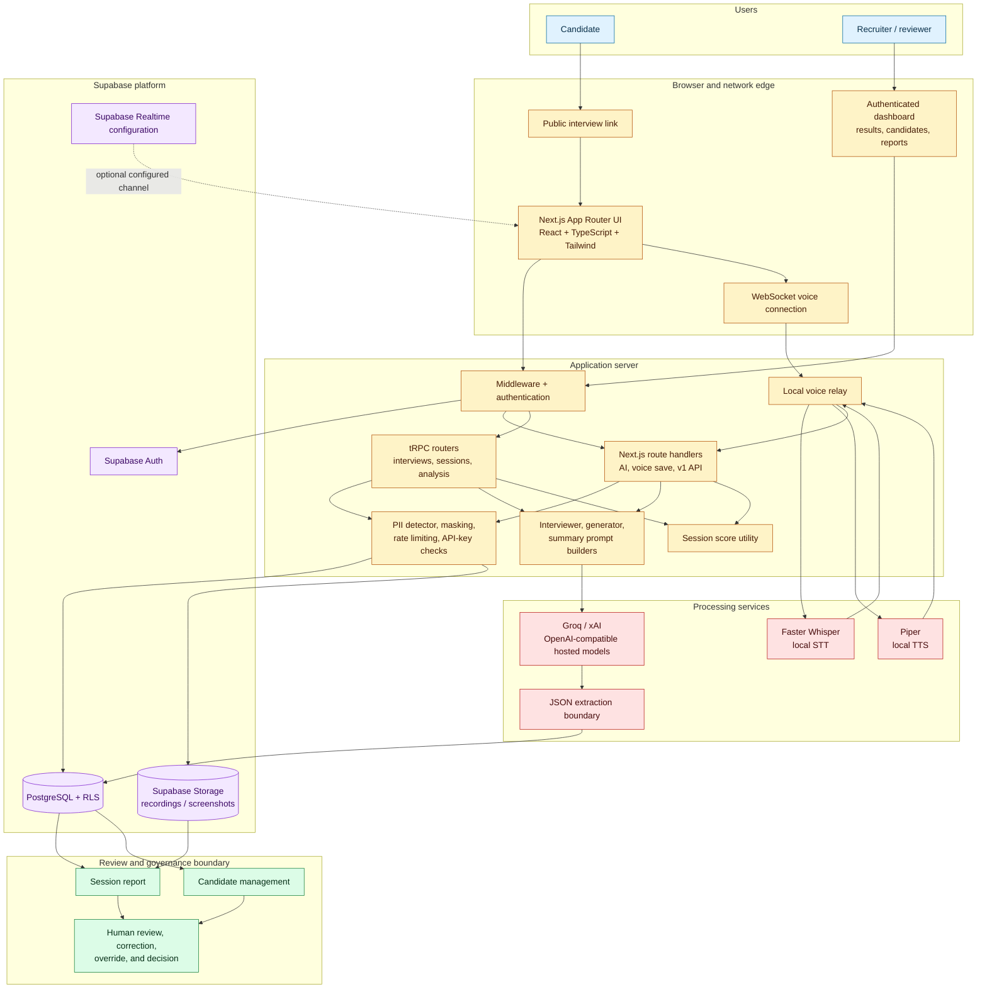

# Bheem AI Interview Bot

## 1. Problem Statement
Recruiters often spend significant time conducting repetitive screening interviews and comparing large numbers of candidate responses.
Candidates may not clearly understand when AI is being used, what information is collected, or how their responses will be evaluated.
Interview platforms can send unnecessary personal information to AI providers and retain sensitive recordings, transcripts, and screenshots without clear controls.
Automated scores can also introduce unfairness when they rely on tone, confidence, personality, or other signals that are not directly related to job requirements.
Bheem addresses these challenges through structured AI interviews, data minimisation, privacy notices, secure storage, and human review of AI-generated results.

### Key Problem Points
1. **Repetitive screening:** Bheem conducts structured chat and voice interviews consistently, reducing manual screening effort.
2. **Unclear AI use:** Bheem displays AI, data-use, recording, and sensitive-data notices before the interview begins.
3. **Excessive data exposure:** Bheem uses PII detection and masking to minimise unnecessary personal data before AI processing.
4. **Privacy and fairness risks:** Bheem is designed to secure interview data and keep recruitment evaluation focused on job-relevant evidence.
5. **Uncontrolled automated decisions:** Bheem treats AI scores as advisory results that require human review before a hiring decision.

## 2. Objectives
1. Provide clear candidate-facing transparency about AI use, data collection, recording, and analysis.
2. Minimise personal data before it reaches hosted AI models or privacy logs.
3. Protect interview data through access control, retention, deletion, and candidate-rights workflows.
4. Ensure recruitment decisions are based on relevant evidence and human oversight rather than unchecked AI output.

## 3. Tools and Technology Stack
### Application and frontend

- Next.js 14 with App Router
- React 18
- TypeScript
- Tailwind CSS
- Radix UI components
- Lucide React icons

### Backend and APIs

- Next.js route handlers
- tRPC
- Zod validation
- Node.js
- WebSocket voice relay

### AI and voice processing

- Groq and xAI model providers through OpenAI-compatible APIs
- OpenAI SDK client
- Local Faster Whisper speech-to-text service
- Local Piper text-to-speech service
- PII detection and masking utilities
- Structured JSON extraction for AI reports

### Database, authentication, and storage

- Supabase Auth
- PostgreSQL
- Supabase Storage
- Row Level Security policies
- Supabase Realtime configuration

### Testing and development

- Node.js test runner
- TypeScript compiler
- ESLint
- Playwright functional tests
- Supabase local development environment
- Git and GitHub repository workflow

## 4. Implemented Features

- Chat and voice interviews with configurable AI interviewers.
- Question generation, resume parsing, summaries, and candidate scoring.
- Candidate onboarding with microphone, camera, and screen checks.
- AI-use, data-use, recording, and sensitive-data notices.
- PII detection, masking, access control, signed URLs, authentication, and rate limiting.

## 5. Features Yet To Be Implemented

- Persist candidate acknowledgement and privacy-notice version.
- Apply shared PII minimisation to every AI request and remove raw PII from privacy logs.
- Disable emotion, personality, confidence, and sentiment analysis for recruitment.
- Make AI scores advisory and require human review, correction, and override.
- Fix storage access, ownership checks, retention, deletion, export, and appeal workflows.
- Add AI invocation logs, model and prompt tracking, incident handling, and reviewer training.

## 6. Data Flow Explanation

### Data flow steps

1. The candidate sees the AI-use, data-use, recording, and sensitive-data notices. Continuing starts the interview; leaving stops the flow before interview answers are collected.
2. The browser performs device and anti-cheating checks, then collects text, voice, video, choice answers, whiteboard drawings, code, and optional recordings according to the interview configuration.
3. Text and voice answers enter the Bheem application through Next.js APIs or the WebSocket voice relay. Local Faster Whisper transcribes voice, and local Piper speaks interviewer responses.
4. Authentication and project/session access checks run before persistence or review access. Candidate messages are passed through PII detection and masking, with privacy-event metadata recorded separately.
5. The interviewer model receives the interview script, current question, conversation context, and permitted answer data. It returns the next question or a follow-up according to the configured follow-up depth.
6. PostgreSQL stores interview configuration, questions, sessions, messages, progress, and generated reports. Supabase Storage holds recordings and screenshots; signed URLs are used for protected media access.
7. On completion, report generation loads the transcript, objective, assessment criteria, questions, code, and whiteboard context and sends the report input to the hosted report model.
8. Structured JSON extraction stores the summary, themes, sentiment, question evaluations, criterion evaluations, tone analysis, and research findings in the session report.
9. The results and candidate-management views display the report and scores. A human reviewer must interpret the advisory AI output before making an organisation or hiring decision.

### 6.1 Evaluation path inside the data flow

The headline score is not a weighted combination of every signal. It is calculated as the arithmetic mean of valid per-question scores; criterion scores are only used as a legacy fallback when no valid question score exists. Tone, sentiment, themes, duration, anti-cheating events, and human review do not change the numeric score automatically.

## 6.2 System architecture

### Architecture responsibilities

- **Browser:** presents notices, runs interview interaction and device checks, captures configured media, and displays candidate or reviewer views.
- **Application server:** authenticates requests, enforces project/session access, saves messages and progress, coordinates voice, builds prompts, and stores generated reports.
- **Local voice services:** keep speech-to-text and text-to-speech processing on the local service path when voice mode is enabled.
- **Hosted AI providers:** generate interviewer turns and post-interview analysis from the data included in each prompt.
- **Supabase:** provides authentication, PostgreSQL persistence with RLS, protected media storage, and optional realtime configuration.
- **Scoring utility:** averages valid question scores and uses criterion scores only as a fallback; it does not make the hiring decision.
- **Human review:** interprets the AI output and remains the required decision boundary for recruitment use.

## 7. Conclusion

Bheem already provides the core AI interview experience and has useful privacy foundations, including PII utilities, access controls, signed URLs, tests, and candidate-facing notices.

The next implementation focus is to complete the privacy boundary around the AI interview. The highest-priority work is to persist candidate acknowledgement, apply minimisation consistently to every AI request, remove unsafe emotion-style evaluation, secure storage and privacy-event access, define retention and deletion, and require human review of AI-generated scores.

After these controls are implemented, Bheem will have a clearer, safer, and more transparent foundation for further EU AI Act, GDPR, security, and governance work.
